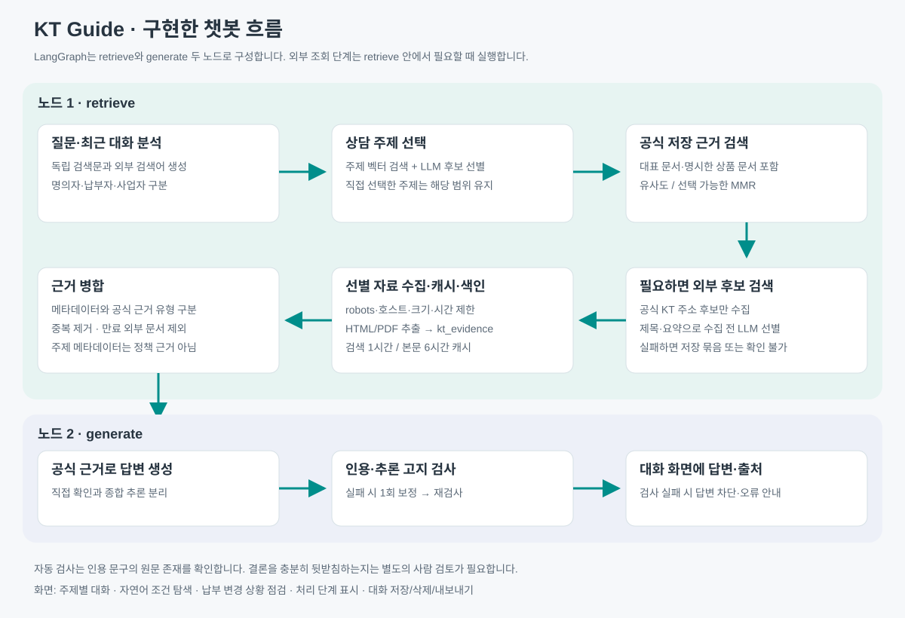

# KT Guide 실행 안내

## 시작

프로젝트 PowerShell에서 다음 명령을 실행합니다.

```powershell
.\run-chat.ps1
```

브라우저에서 http://127.0.0.1:8765 를 엽니다. 현재 PC에서는 `config/local.json`의 Python 환경을 사용합니다.

새 환경에서는 Python 3.12 가상환경에 `requirements.txt`를 설치하고 `.env.example`을 `.env`로 복사한 뒤 GMS 키를 입력합니다. 모델은 사용자 지정 `gpt-6.1-sol`입니다. 모델을 임의로 변경하지 않습니다. 첫 색인은 `run.ps1 index`로 만듭니다. 모델 다운로드/설치는 네트워크가 필요하며, `run-chat.ps1`은 이미 준비된 모델을 오프라인으로 사용합니다.

## 화면

- 사이드바: 지원 주제 101개 필터·선택, 근거 준비 중인 초안 2개 별도 표시. 좁은 화면에서는 왼쪽 위 메뉴를 엽니다.
- 조건으로 상담 주제 찾기: 자연어 상황에서 관련 주제를 선별하고 카드로 제시합니다. 카드를 누르면 해당 주제의 대화로 이어집니다.
- 납부 변경 상황 점검: 회선 명의자·기존 납부자·새 납부자·유지할 할인 상품을 구분한 질문을 작성합니다. 답변은 동일한 공식 근거 검색을 거칩니다.
- 새 대화: 주제를 자동 선택하는 일반 상담입니다. 직접 선택한 주제의 대화는 해당 주제 범위에서 답합니다.
- 답변: 공식 원문에서 확인한 내용과 문서 종합 추론을 구분합니다. 직접 명시되지 않은 추론은 그 사실을 반드시 고지합니다.
- 인용 번호: 누르면 검증 정보가 열립니다. 사용한 원문 문구와 공식 출처를 확인할 수 있습니다.
- 대화 기록: 이 브라우저의 localStorage에 저장합니다. 주제별 대화가 구분되며 삭제와 Markdown 내보내기를 제공합니다. 좁은 화면에서 내보내기 버튼은 숨겨집니다.
- Enter 전송 / Shift+Enter 줄바꿈. 한 번에 요청 하나를 처리합니다.

## 파이프라인

LangGraph의 노드는 `retrieve`, `generate` 두 개입니다.

`retrieve`: 질문·최근 6개 메시지 → 주제 직접 선택 또는 벡터 검색과 주제 선별 → 선택 주제 문맥을 포함한 짧은 독립 검색문 → 대표 문서 및 연결 공식 근거 검색 → 필요하면 외부 후보 검색·수집 선별·캐시·색인 → 근거 병합.

`generate`: 주제 메타데이터와 공식 근거를 유형별로 전달 → JSON 답변 → 인용 ID와 원문 문구 일치·추론 고지 검사 → 답변과 실제 사용 출처만 표시.

주제 메타데이터는 탐색용이며 공식 정책 근거가 아닙니다. 대표 문서는 검색 점수와 추가 문서 길이 제한에 우선해 유지합니다.

## 외부 조회와 캐시

기본은 내부 공식 자료를 사용합니다. 내부 자료가 없거나 특수·변동 정보이면 외부 조회를 시도하며 ‘공식 웹 추가 조회’를 켜서 직접 요청할 수도 있습니다.

- 검색: 공개 Bing RSS에서 공식 KT 주소만 후보로 받습니다. 검색 결과의 제목·요약을 후보 선별 프롬프트에 넣어 관련 후보만 최대 2개 고릅니다.
- 수집: HTTPS 공식 호스트만 허용하고 robots 규칙·응답 크기·리다이렉트를 확인합니다. HTML/PDF 본문을 추출합니다. 로그인·스크립트 렌더링이 필요한 페이지를 우회하지 않습니다.
- 캐시: 검색 1시간, 성공한 빈 검색 5분, 본문 6시간. 유효한 캐시가 있으면 같은 요청을 반복하지 않습니다. 만료된 본문은 답변용 외부 근거에서 제외합니다. 수집일과 상품 유효기간은 다릅니다.
- 색인: 기존 공식 원문과 같은 `kt_evidence` 컬렉션에 live 문서/수집 시점/만료 시점/관련 주제/출처/버전을 구분해 저장합니다. 같은 URL을 여러 주제에서 사용해도 연결을 보존하며 중복을 늘리지 않습니다.
- 조회 제한: 시간 초과·robots 확인 불가·검색 실패 시 이를 기록하고 저장된 공식 자료를 이용하거나 확인 불가로 안내합니다. 저장 자료 사용을 최신 웹 조회 성공으로 표현하지 않습니다.
- 현재 실제 검색 응답과 후보 제외 경로는 확인했습니다. KT 본문 신규 다운로드는 환경별 접속 제한으로 성공이 보장되지 않습니다. 수집·색인·TTL·버전 교체는 모의 HTTP와 실제 Chroma 테스트로 검증했습니다.
- 카드사 사이트 등 KT 이외 주소는 현재 수집 허용 목록 밖입니다. 해당 조건은 공식 카드사에서 직접 확인하도록 안내합니다.

외부 캐시는 `.runtime/external/`에 저장되며 Git에서 제외됩니다. 원본 MD는 바꾸지 않습니다.

## 설정

`config/retrieval.json`: 청크 크기/겹침, Top-k, `evidence_search_mode`(similarity/mmr), `mmr_fetch_k`, `mmr_lambda`.

검색 설정 또는 원본을 바꾸면 `run.ps1 index`를 실행해 색인 매니페스트를 갱신합니다. 임베딩 캐시는 재사용됩니다.

일회성 비교: `run.ps1 search "질문" --evidence-mode mmr`.

`config/chatbot.json`: 외부 조회 활성화, 요청 시간 제한/간격/크기, 수집 최대 수, 검색·문서 캐시 TTL, 추가 근거 길이.

`prompts/01_chat_query.md`, `02_topic_select.md`, `02_document_select.md`, `03_generate.md`: 검색문 생성, 상담 주제 선택, 수집 후보 문서 선별, 답변 생성. 기존 `01_search_plan.md`는 상세 질문 분석 실험 CLI용으로 유지합니다.

## 검증과 한계

54개 자동 테스트 통과. 최초 질문/후속 질문/개인별 사은품 근거 부족/저장 공식 문서 조회의 실제 GMS·LangGraph 검증을 수행했습니다. 자동 인용 검사는 원문 존재를 확인하는 검사이며 의미적 타당성 전체를 입증하지 않습니다.

주제 103개는 초안이며 근거 미연결 2개와 부분 연결 27개가 있습니다. 전체 상담 정확도나 모든 상품 적용을 보장하지 않습니다. 일반 질문의 후보 선택에는 103개 요약 목록을 함께 사용하므로 비용과 대기 시간이 있습니다. 측정한 네 사례는 약 24~51초입니다.

현재 스트리밍은 처리 단계와 최종 답변을 전달합니다. 생성 중인 단어를 하나씩 내보내지는 않습니다. 최종 답변을 검증한 후 표시하기 위해서입니다.

API 키와 원문 오류·추적 정보는 화면에 보내지 않습니다. 로컬 127.0.0.1로만 열며, 다른 Origin과 비 JSON 요청을 차단합니다. 질문·최근 대화·필요한 공식 근거는 GMS로 전달됩니다. 공개 검색에는 업무명·상품명 중심의 검색문만 전달하며 긴 숫자열/이메일을 포함한 검색문은 제외합니다.

공개 서비스 배포·인증·개인별 가입정보 조회는 현재 범위에 없습니다. 자료 이용 조건은 공개 열람 가능 여부와 재배포 허용 여부를 구분해 추가 검토해야 합니다.

인용 문구의 공백 차이는 원문 구간으로 복원합니다. 단어·의미가 바뀐 인용은 거절하며, 실패 시 생성 답변을 한 번만 보정한 뒤 재검사합니다. 보정 후에도 실패하면 출력하지 않습니다.



특정 상품명이 명확하면 해당 상품의 저장 공식 문서도 함께 포함합니다. 초안의 상담 주제 연결만으로 특정 상품 문서를 놓치는 문제를 보완했습니다.

GMS가 HTTP 502/503/504를 반환하면 한 번만 재시도합니다. 429(제한 초과)와 일반 오류는 자동 반복하지 않습니다. 인용 검증 실패에 대한 1회 보정은 별도이며, 보정 후에도 실패하면 답변을 차단합니다.

최종 특정 상품 검증: 프리미엄 싱글결합 저장 원문 5개를 포함하고 실제 해당 상품 문구를 인용해 TV만 해지하는 상황을 조건부로 답했습니다. 일시 모델 오류 1회 재시도 후 약 85초에 완료했습니다. 재약정·타사 이동의 개인별 금액은 자료 없이 확정하지 않았습니다. 초반 네 사례(24~51초)보다 느린 오류 재시도 사례도 있으므로 일정한 응답 시간을 보장하지 않습니다.

## 2026-10-23 1단계 보완

선택 주제의 이름·설명·범위 등을 검색어 생성에 전달합니다. 주제 메타데이터는 정책 근거가 아닙니다. 자동61개/실제 검색문4개 검증. 실행 중 서버는 재시작이 필요하며 재색인은 필요 없습니다.

## 2026-10-23 2단계: 서비스 지원 범위

메타데이터103개는 보존하며 챗봇 지원101개와 미지원 조사 초안2개를 분리합니다. 재약정 비교(internet_renewal_comparison), 이중계약 피해 상담(internet_sales_dispute)은 대표 공식 근거를 준비 중이므로 선택·자동 추천·직접 요청을 제한합니다. 기존 대화는 열람 가능하며 원본MD는 변경하지 않았습니다. 자동68개/실제HTTP/UI 검증. 재색인 완료, 실행 중 서버는 재시작 필요.

## 2026-10-23 3단계: 근거 유형 구분

답변의 탐색용 주제 정보는 정책 근거가 아님을 별도 표시합니다. 실제 인용 문서만 FAQ/서비스 가이드/상품/할인/제휴혜택/약관PDF 등 유형과 원문 형식·출처 경로·PDF쪽 정보로 표시합니다. 과거 결과의 유형이 없으면 미기록으로 표시합니다. 자동76개/실제 GMS·UI 검증, 원본1426개 보존. 재색인은 불필요하며 서버 재시작과 브라우저 새로고침으로 반영됩니다.
