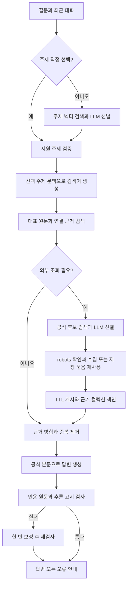

# KT 상담 RAG 파이프라인

위 흐름의 주제선택부터 병합까지는 retrieve, 생성부터 검증까지는 generate 노드다. 탐색 메타데이터는 검색 안내이며 정책 인용 근거가 아니다. 자동 선택은 직접 선택보다 모델 호출이 하나 더 필요하다.

## 자료와 청킹

| 종류 | 원본 보존 단위 | 선택 이유 |
|---|---|---|
| FAQ 1,043개 | 질문·답변 한 항목당 MD 하나 | 짧은 질의 의도와 적용 조건을 함께 검색 |
| 서비스 가이드 21개 | 메뉴 한 항목의 본문·표·주의사항 | 신청 절차·서류·예외의 연결 보존 |
| 결합상품 45개 / 요금제 151개 | 상품 상세의 절 단위 | 상품별 적용 조건을 구분 |
| 납부혜택 22개 / 할인 7개 | 안내 절 단위 | 공통 혜택과 특수 조건 구분 |
| 약관 137개 | 선택한 조항·PDF 쪽 범위 | 필요한 유지·해지 조건 확인 |

data/chunks의 1,426개 MD는 원문 보존용 부모 청크다. 임베딩에는 기본 360토큰·48토큰 겹침의 자식 청크 2,091건을 사용한다. 표·문맥 확인은 부모 본문으로 한다. PDF 전체를 모두 수집·청킹한 것으로 설명하지 않는다. 원문 주소·추출 범위는 data/SOURCES.md에 있다.

## 저장과 경계

- data/topics: 103개 탐색 초안. 근거 없는 2개는 unsupported_draft이며 서비스 선택을 차단한다.
- .runtime/chroma: kt_task_meta / kt_evidence. 로컬 생성물이며 Git 제외.
- .runtime/embeddings.sqlite3: 모델·입력 해시 기반 벡터 캐시.
- .runtime/external: 검색 1시간, 성공한 빈 검색 5분, 본문 6시간. 실패 응답은 정상 결과로 캐시하지 않는다.
- 같은 문서 버전·수집시점·만료시점·주제 연결이면 재임베딩·upsert를 생략한다. 주제가 추가되거나 버전이 달라지면 갱신한다.
- .env는 서버만 읽으며 브라우저로 전달하지 않는다. 대화는 브라우저 localStorage에 남고 최근 대화는 GMS로 전송된다.
- 본문 수집 제한 시 저장 자료 대체를 기록한다. 저장 자료를 최신 웹 확인으로 표현하지 않는다.
